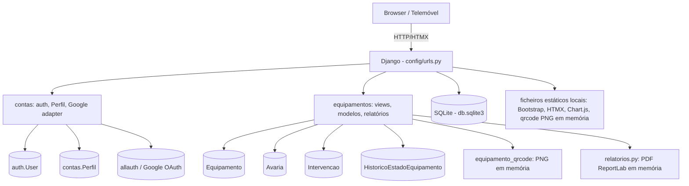
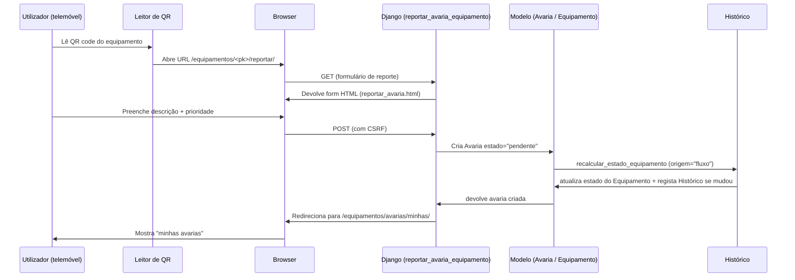

# 06. Arquitectura

> **Regra de elaboração:** arquitectura descrita exclusivamente a partir do código existente. Quando algo não existe no código, escreve-se "NÃO EXISTE".

## 1. Padrão MVT do Django aplicado ao projecto

O projecto segue o padrão Model-View-Template (MVT) do Django, com dois apps principais:

### Modelo (Model) — `equipamentos/models.py` e `contas/models.py`

- `Equipamento`, `Avaria`, `Intervencao`, `HistoricoEstadoEquipamento` (app `equipamentos`).
- `Perfil` (app `contas`), ligado 1:1 a `django.contrib.auth.models.User`.
- Lógica de negócio concentrada na função `recalcular_estado_equipamento` (`equipamentos/models.py` linhas 53-97), que é chamada pelos `save()` do modelo e pelas views.

### View — `equipamentos/views.py` e `contas/views.py`

- Todas as views de negócio estão em `equipamentos/views.py` (views baseadas em função).
- Decorators personalizados de permissão (`tecnico_ou_admin_required`, `admin_required`) no mesmo ficheiro.
- `contas/views.py` apenas tem `dashboard_redirect` (view da raiz `/`). Login/logout usam `django.contrib.auth.views` (`contas/urls.py` linhas 8-9).
- Login social Google é gerido por `allauth` com adapter personalizado `contas/adapters.py` (`ContasSocialAccountAdapter`).

### Template — `templates/`

- `templates/base.html`: template base com navbar UCM, topbar, mensagens e importação de estáticos locais.
- `templates/contas/`: `home.html`, `login.html`.
- `templates/equipamentos/`: listas, fichas, dashboard, etiquetas, reporte e partials (`_avarias_conteudo.html`, `_badge_*.html`).

### Controller/URLs — `config/urls.py`, `contas/urls.py`, `equipamentos/urls.py`

- `config/urls.py` (linhas 21-26): `admin/`, `accounts/` (allauth), `contas/` (login/logout), `equipamentos/`, `""` (home → `dashboard_redirect`).
- Namespace `equipamentos` definido em `equipamentos/urls.py` linha 5.

## 2. Apps e responsabilidades

| App | Ficheiros principais | Responsabilidade |
|-----|---------------------|------------------|
| `config` | `settings.py`, `urls.py`, `wsgi.py`, `asgi.py` | Configuração do projeto, URLs raiz, WSGI/ASGI. |
| `contas` | `models.py` (`Perfil`), `signals.py`, `adapters.py`, `views.py`, `urls.py`, `context_processors.py`, `admin.py`, `management/commands/importar_utilizadores.py` | Autenticação, perfis/papéis, login Google restrito a domínio, sinal de criação automática de perfil, importação CSV de utilizadores. |
| `equipamentos` | `models.py`, `views.py`, `urls.py`, `forms.py`, `admin.py`, `relatorios.py`, `management/commands/seed_demo.py` | Inventário, avarias, intervenções, histórico de estados, QR codes, relatórios PDF, dados de demonstração. |

Não existe um camada de "services" separada: a lógica de negócio reside na função `recalcular_estado_equipamento` no modelo e diretamente nas views. Não existe ficheiro `services.py` nem `business_logic.py`.

Sinais utilizados:
- `contas.signals`: `post_save` sobre `User` → `criar_ou_atualizar_perfil_utilizador` (cria `Perfil`). Registado em `contas/apps.py` `ready()`.
- Não existem sinais personalizados no app `equipamentos`.

## 3. Fluxo de um pedido HTMX (exemplo: filtrar avarias)

O HTMX é carregado localmente (`static/vendor/htmx/htmx.min.js`, referenciado em `templates/equipamentos/avarias_lista.html` linha 91).

Fluxo (com base em `equipamentos/views.py` e `templates/equipamentos/avarias_lista.html`):

1. O utilizador altera o `<select>` de estado/prioridade no formulário de `/equipamentos/avarias/`.
2. O formulário tem atributos HTMX: `hx-get`, `hx-target="#avarias-conteudo"`, `hx-swap="outerHTML"`, `hx-trigger="change, submit"`, `hx-push-url="true"` (`avarias_lista.html` linhas 41-47).
3. O navegador envia um GET com `HX-Request` no cabeçalho para a mesma view `avarias_lista`.
4. Na view (`views.py` linha 192), `request.headers.get("HX-Request")` é verdadeiro → a view renderiza apenas o partial `equipamentos/partials/_avarias_conteudo.html` (não a página inteira).
5. O HTMX substitui o elemento `#avarias-conteudo` pelo HTML devolvido e atualiza o URL do navegador (`hx-push-url`).
6. Se não houver HTMX (pedido normal ou sem JavaScript), a view renderiza a página completa `avarias_lista.html` (linha 199).
7. Ações assíncronas na listagem (assumir avaria, mudar estado) usam formulários com `hx-post`, `hx-target="#avarias-conteudo"`, `hx-swap="outerHTML"` e CSRF (`_avarias_conteudo.html` linhas 117-151).

Mensagens de sucesso/erro nas respostas HTMX são renderizadas dentro do partial (`_avarias_conteudo.html` linhas 37-44) quando `request.META.HTTP_HX_REQUEST` e existem mensagens.

## 4. Geração do QR code

- View: `equipamento_qrcode` (`equipamentos/views.py` linhas 674-713), URL `/equipamentos/<pk>/qrcode.png`, decorador `@login_required`.
- Conteúdo do QR: o URL absoluto da página de reporte de avaria do equipamento (`reverse("equipamentos:reportar_avaria_equipamento", kwargs={"pk": ...})`), obtido via `url_absoluta(request, path)` (`views.py` linhas 86-92).
  - Se `settings.SITE_URL` estiver definido, usa esse como base (ex: `http://192.168.1.10:8000`).
  - Senão, usa `request.build_absolute_uri(path)` (host do pedido).
- Geração: biblioteca `qrcode` com `ERROR_CORRECT_M`, `box_size=10`, `border=4`, imagem preto em branco (`views.py` linhas 691-701).
- Saída: PNG em memória (`io.BytesIO`), `HttpResponse` com `Content-Type: image/png` e `Content-Disposition: inline; filename="qrcode-<slug>.png"`; `Cache-Control: private, max-age=3600` (não é público porque o URL pode mudar entre pedidos).
- O QR code **não aponta para a fiche do equipamento** (`get_absolute_url`), mas sim para o reporte de avaria (confirmado pelos testes `test_qrcode_contem_o_url_de_reporte_de_avaria` e `test_9_qrcode_contem_url_de_reporte_e_nao_da_ficha`).
- Nenhum ficheiro de imagem é guardado no disco.

## 5. Segurança

### Decorators de permissão
- `tecnico_ou_admin_required` (`views.py` linhas 39-56) e `admin_required` (`views.py` linhas 65-78) combinam `@login_required` com verificação do perfil; elevam `PermissionDenied` (HTTP 403) em caso de falha.

### CSRF
- Middleware `django.middleware.csrf.CsrfViewMiddleware` ativo (`settings.py` linha 58).
- `` presente em todos os formulários POST (`reportar_avaria.html`, `avaria_detalhe.html`, `_avarias_conteudo.html`, `equipamento_detalhe.html`, `login.html`, `etiquetas.html`).
- Pedidos HTMX POST incluem o token CSRF nos formulários (`_avarias_conteudo.html` linha 123).

### ALLOWED_HOSTS
- `settings.py` linhas 29-31:
  ```python
  ALLOWED_HOSTS = ["127.0.0.1", "localhost"] + [
      h for h in os.environ.get("DJANGO_ALLOWED_HOSTS", "").split(",") if h
  ]
  ```
- Hosts adicionais via variável de ambiente `DJANGO_ALLOWED_HOSTS`.

### SITE_URL
- `settings.py` linha 171: `SITE_URL = os.environ.get("SITE_URL", "")`. Usado nos QR codes e vazio por omissão (usa o host do pedido).

### Login Google (allauth)
- `SOCIALACCOUNT_ADAPTER = "contas.adapters.ContasSocialAccountAdapter"` (`settings.py` linha 151).
- O adapter valida que o email está verificado e que o domínio está em `ALLOWED_EMAIL_DOMAINS` (por omissão `ucm.ac.mz,estudante.ucm.ac.mz`) antes de concluir o login (`contas/adapters.py` linhas 29-50).
- O parâmetro `hd` do Google é apenas sugestão de interface; a validação efetiva é no servidor.

### Outros
- `DEBUG = True` e `SECRET_KEY` hardcoded em `settings.py` (linhas 24, 27) — adequado apenas a desenvolvimento.
- Validação de parâmetros de filtro (`estado`, `prioridade`) contra as `CHOICES` para ignorar valores manipulados no URL (`views.py` linhas 100-107, 583-585).
- `Middleware` completo: Security, Sessions, Common, Csrf, Auth, Messages, Clickjacking (XFrameOptions), allauth AccountMiddleware (`settings.py` linhas 54-63).
- `MAILERS` com backend de email de console (`settings.py` linhas 182-185) — emails não são enviados de fato.

NÃO EXISTE: HTTPS forçado (`SECURE_SSL_REDIRECT` não configurado), HSTS, Content Security Policy, rate limiting, autenticação de dois fatores, chave secreta a partir de variável de ambiente.

## 6. Diagramas Mermaid

### Componentes



### Sequência — reporte de avaria por QR



NÃO EXISTE: diagrama de containers (não há serviços separados), balanceador de carga, fila de tarefas (Celery), cache (Redis/Memcached), serviço de email externo, API Gateway.
